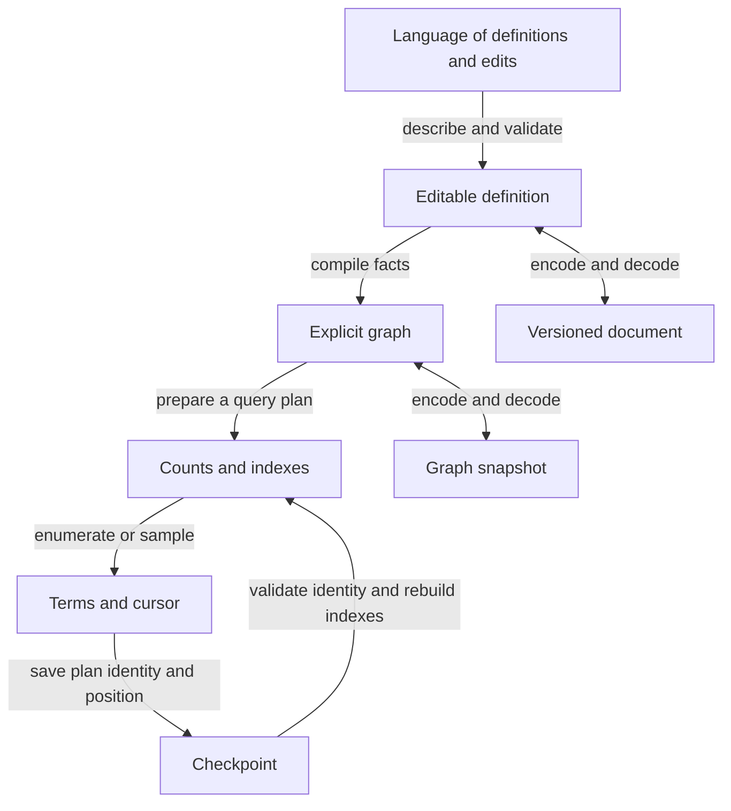

# Representation levels of an editable language

Status: investigation and implementation plan. The APIs in the current-support
column below exist. The document, file, checkpoint, and edit interfaces in the
plan do not yet exist.

The required workflow is: define a language, inspect it, save it, reopen it,
change it, and continue synthesis, indexing, or sampling. The language can be
an FTA, an ECTA, or an LTA. Each edit produces a new version. Keep the previous
version available for comparison and undo.

## What each level retains

These are different representations, with different round-trip contracts.
They do not require a new runtime hierarchy. Use the existing explicit graph
at the boundary described in [ADR 4](adr/0004-explicit-graph-boundary.md).

| Level | Required data | Current support and gap |
| --- | --- | --- |
| Editable definition | Named constructors, states, transitions, individual facts, source locations, and imports | Explicit rows and the quoter in PR 72 cover graph construction. Named removable facts and a complete document are missing. |
| Explicit graph | Initial state, complete rows, ordered children and alternatives, symbols, refinements, and constraints | `Data.CFTA.FTA` holds this data. `Interned.toFTA` exports a closed interned graph. |
| Prepared query | Graph version, query route, order policy, bounds, weights, decoder, and solver assumptions | `Sized` and `Gen` prepare queries. Their closures and memo tables are not portable values. |
| Run checkpoint | Query identity and next enumeration position, or sampler state | No portable checkpoint API exists. A rank alone is insufficient. |
| Meta-language | Terms that describe definitions and edit requests | A possible later frontend. It must use the same document validation and edit semantics. |

An import from a compiled graph can create an editable document. It cannot
recover source names, comments, deleted alternatives, or separate facts that
compilation has combined. Mark imported facts as combined facts. Do not invent
an earlier source definition.

## Three boundaries that affect correctness

### Keep the facts before compilation

`Constraint.conjoinConstraints` combines equality classes. The facts
`a = b` and `b = c` compile to the same equality class as `a = b` and `a = c`.
The compiled value cannot identify which second fact the author supplied.
Removing one original fact therefore requires its identity and its original
body. Store those facts in the editable definition and compile the remaining
facts after removal. Retain an impossible definition too: removing a false fact
must be able to restore alternatives that pruning discarded.

Constraint removal is not logical negation. Removing `positive` removes an
obligation; adding `not positive` adds a different obligation. Keep named facts
at their attachment sites. A fact on one transition does not constrain another
transition that accepts the same term.

### Keep the graph and the rank plan

Two graphs can accept the same terms and assign different ranks. The current
`SizedSpec` has an example where importing through interned nodes removes a
dead transition. That changes the canonical classes used to order alternatives.
The accepted terms remain the same, but their order changes. A graph codec must
therefore preserve dead rows and repeated alternatives. It must not trim,
minimize, sort alternatives, or import through interned nodes during decoding.

`Data.CFTA.Sized` ranks structural size classes. Its order sorts transitions by
arity, symbol, and canonical child classes, then uses nested products. A finite
`Gen` import can use a different order and size model. A saved cursor must name
the query route and its version, as well as the graph. Store a size and class
rank for a sized query, and the next rank for a finite query. An empty size
class is not the end of a recursive language.

An edit invalidates an old cursor for the new version. Resume the old version,
or explicitly find the saved term in the new version and obtain its new rank.
The latter is relocation, not continuation of the same enumeration. It can
repeat or skip terms relative to the old run. Report a removed term explicitly.

### Keep declarative data separate from host code

`Formula`, `Guard`, paths, and substitutions are declarative. Serialize their
constructors and values. Do not serialize intern identifiers or solver caches.
`Gen.Recipe` can contain Haskell functions, custom order functions, arbitrary
values, and opaque QuickCheck generators. Its support graph does not reconstruct
those values or their decoder. Reject unsupported exports explicitly.

`Generic.constructorLabel` includes a package unit identifier and is documented
as stable within one build. Saving its text preserves a tree label, but does
not supply a portable Haskell datatype decoder. Typed reopening needs an
explicit constructor schema and a checked host adapter. A document must name
that schema and reject an incompatible adapter.

## Edit semantics and usable operations

Use separate operations for separate meanings. Expose a preview with affected
states, transitions, and facts. Show counts or example terms only when the
selected query can compute them. An unavailable count must not block a valid
graph edit or appear as zero.

| Request | Meaning | Existing mechanism or next step |
| --- | --- | --- |
| Add a constructor | Declare a symbol and arity, then add its productions at named states | `mkFTA`; atomic `replaceRows` in PR 70. A declaration without a production need not add terms. |
| Remove a constructor | Remove every production of that constructor in the selected scope | Filter explicit rows. Distinguish one full refined symbol from all symbols with a shared display text. Report affected references and facts. |
| Add a whole term | Union the root language with that exact tree | `fromTerms` plus interned `union` exist. An explicit-graph union can retain state names and avoid normalization. Validate the combined ranked alphabet. |
| Remove whole terms | Exclude exact trees only at the initial state | Convert each term to a hole-free `TemplateNode`, then use `Template.excludeFTA`. |
| Remove expressions anywhere | Exclude every term that contains a matching subtree | `Template.excludeAnywhereFTA`; recursive inputs are supported. |
| Restrict by a pattern | Keep matching trees, with holes for unconstrained subtrees | `Template.restrictFTA`. |
| Change a production | Replace its symbol, ordered child references, or facts | Atomic row edits exist in PR 70. A document needs stable transition identities. |
| Add or remove a constraint | Add or remove one named fact at its attachment site | Preserve individual facts, then compile their conjunction. An imported combined fact can be replaced as a whole. |
| Replace a subexpression | Define whether the target is one occurrence or all occurrences | Term paths already edit concrete terms. Grammar rewrites need explicit scope, capture rules for binders, and a separate contract. |

For example, removing the whole term `f(a)` must retain `f(f(a))`. Removing
`f(a)` anywhere must reject both. Removing a production that happens to accept
`f(a)` is different: another production might still accept it. Do not implement
term removal by deleting one derivation.

There is no need to implement finite-pattern exclusion again. The current
`Template` operations retain annotations and split transitions by matching
obligations. They preserve unambiguity of an unambiguous input. Their documented
worst case is exponential in overlapping templates. Measure edit cost and the
size of the result on shared, recursive, and constrained inputs.

General subtraction of two arbitrary constrained languages is a separate
capability. Ordinary recognizable tree languages have Boolean closure, but
that theorem alone does not establish a practical subtraction algorithm for
this library's LTA guards and solver behavior. Do not approximate subtraction
by a finite enumeration without an explicit bound. See the closure construction
in [TATA, section 1.3](https://www.eecs.harvard.edu/~shieber/Projects/Transducers/Papers/comon-tata.pdf).

Use one atomic edit batch with an expected document version. Validate the result
before publishing it. A stale version or a missing selected transition is an
error, not an edit to whichever row now has the same list index. Preserve order
by default. Undo restores the prior definition; it does not guess an inverse
of a normalized graph transformation.

## Persistence and resumption

Start with a self-contained graph snapshot. Follow with an editable document
that retains named facts and edit identities. Use a versioned schema shared by
the readable and compact encodings. Keep format version, language semantics,
constructor schema, and ranking policy distinct.

A snapshot must carry the initial state, every row, children in order, repeated
alternatives, symbols as text plus full refinements, and complete constraints.
Store equality contradiction explicitly. Keep formula syntax unchanged; do not
simplify it while decoding. Formula order participates in symbol order.
Use file-local state references. Reject duplicate state identities, missing
references, invalid tags, unsupported versions, and inconsistent arities.
Validation must not call a solver or enumerate terms.

The text encoding should be usable by tools outside Haskell. JSON supplies
standard strings and arrays. Use arrays where order matters. Store arbitrary
integers, ranks, and counts as decimal strings, because common JSON consumers
cannot represent every integer exactly. These constraints follow from
[RFC 8259, sections 4–6](https://www.rfc-editor.org/rfc/rfc8259.html).
Give decoding errors a document path and, where the parser permits it, a source
position. Reject unknown semantic fields instead of silently dropping a fact.
A formatted view can add constructor names and fact summaries without changing
the saved data. Display all guards and refinements on demand.

For the compact encoding, compare CBOR with a schema-specific binary codec.
CBOR has integer and bignum encodings and deterministic encoding rules.
A deterministic encoding is useful for document digests, but does not make two
equivalent languages have the same digest. See
[RFC 8949, sections 3.4.3 and 4.2](https://www.rfc-editor.org/rfc/rfc8949.html).
Measure encoded size, decode allocation, and instructions before selecting a
binary codec. Keep codecs in an optional package so core users do not acquire
format dependencies.

[Timbuk, as implemented by VATA](https://github.com/ondrik/libvata#input-format),
is useful interchange for ordinary ranked tree automata. Its documented grammar
has symbols, arities, states, final states, and transitions. It does not carry
this library's refinements, guards, or rank plan. Treat it as a separate import
or export capability with explicit restrictions.

A first checkpoint rebuilds indexes from the saved graph. It stores no live
solver process. Record all assumptions, query bounds, ordering, weights, and
required decoder schema. A sampling checkpoint also needs the PRNG algorithm,
its version, and state. A seed alone does not identify a position in a stream.
A timed-out or unknown solver result must remain unresolved on reopening.
It must not become a rejected term or a trusted cached proof.

Cache snapshots are a later optimization. Validate every cache against its
input graph, plan, and solver context. Measure retained memory as well as load
time. For file writes, use a temporary file and atomic replacement; leave the
previous valid document available after an interrupted write.

## Languages that describe languages

A definition or an edit can itself be a term of a language. A meta-language can
constrain candidate productions, propose patches, and use the same synthesis,
indexing, and sampling operations. Begin with a finite constructor schema for
these description terms and a total decoder into the document format.

A syntactically valid description need not be a valid graph. State references,
ranked arities, fact scope, and version preconditions still need validation.
Keep these failures as structured results. Do not claim that one FTA enforces
all semantic validity conditions. A Lean adapter can consume the same
language description and state correspondence checks separately from the
Haskell runtime. Reuse the existing explicit-graph formal boundary.

This permits another level without recursive host-code serialization: terms
describe data, and a named interpreter validates and compiles that data. The
first deliverable remains a usable workflow for an ordinary object language.

## Separate implementation items

1. Graph snapshots: complete text encoding and decoding, all formula and guard
   forms, duplicate and dead alternatives, cycles, and structured failures.
   Verify exact graph equality and two-process term/count/rank replay.
2. Editable documents: stable state, transition, constructor, and fact identities;
   retained individual facts; validated atomic patches and undo. Demonstrate
   that removing a fact restores a branch that compilation had rejected.
3. Edit ergonomics: whole-term versus subtree removal, constructor scope,
   explicit graph union, previews, and errors that identify the selected item.
   Reuse `Template`; compare result languages with independent bounded filtering.
4. Checkpoints: versioned query plans and enumeration cursors, then sampling
   state. Reject stale plans. Resume in a fresh process at the exact next term.
5. Complete inspection: finite graph views with stable document references and
   all constraints, plus a save/edit/load example usable from a clean module.
6. Compact codec: the same schema and validation as text. Measure size and cost
   on shared graphs, cycles, large formulas, and large integer literals.
7. Incremental preparation: dependency-aware validation and count reuse after
   edits, including cycle invalidation. Compare every result with rebuilding.
8. Portable typed adapters and meta-language: versioned constructor schemas,
   bounded generation of definitions and patches, then Lean interchange.

Keep each item in a separate PR. An item may split further when its independent
parts have different acceptance checks. No implementation should depend on a
future cache or meta-language feature to complete the basic workflow.

## Evidence

The source review covers `Data.CFTA`, `Interned`, `Constraint`, `Formula`,
`Generic`, `Template`, `Sized`, `Gen.Internal.Types`, and
`Gen.Internal.Inspection` at main `c0cc8a05`. `drawInspection` currently displays
equalities but explicitly omits other parts of a constraint. It is useful as a
view, but insufficient as the sole display of an editable LTA document.

PR 70 supplies persistent row edits. PR 72 supplies an explicit graph quoter
and file parser whose named bindings remain external values. Neither is a
self-contained language document. The implementation items above preserve
these boundaries rather than treating those PRs as complete persistence.

A capped standalone probe confirms the three boundary examples. The dead-row
graph lists `f(z(k))` before `f(m(k))`; its interned round trip reverses them.
The two fact sets above compile to equal constraints. Named removal retains
the other fact. On a recursive expression graph, whole-term and subtree
exclusion match independent filtering through depth four.

This PR changes documentation only. Package sources and build inputs are
identical to main `c0cc8a05`. The existing strict build, six-suite, formatting,
lint, and eight-cell benchmark evidence for that source tree still applies.
The focused probe runs through heavy-management at 4 GiB with a 4 GiB RTS cap.
